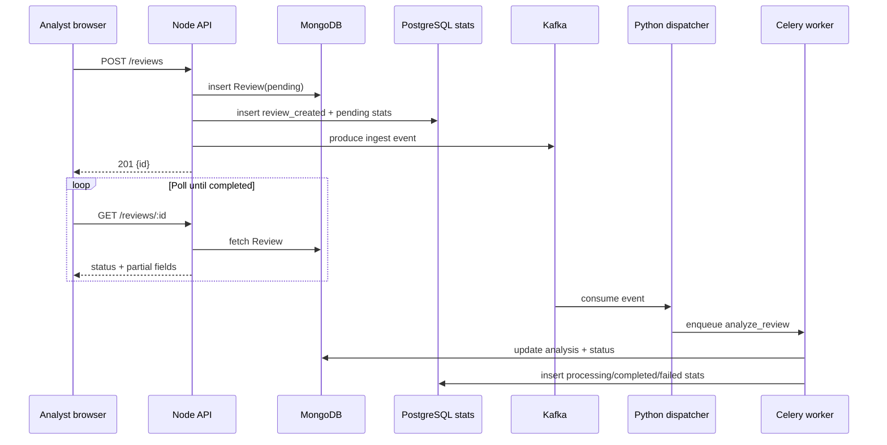
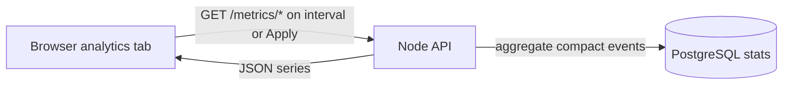
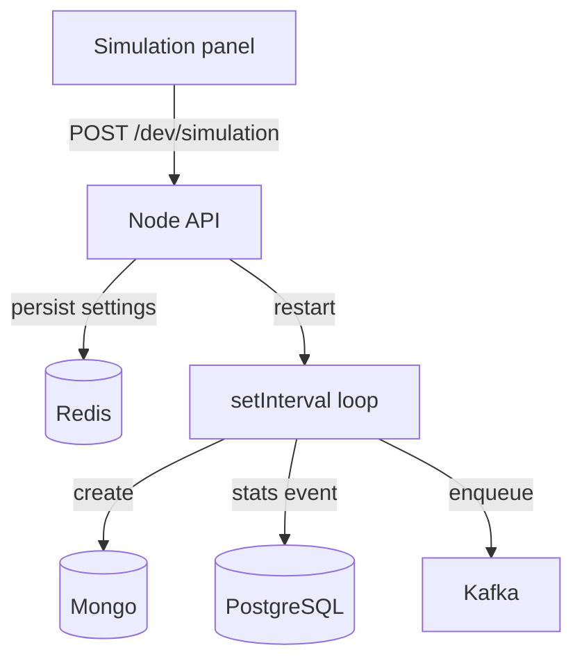
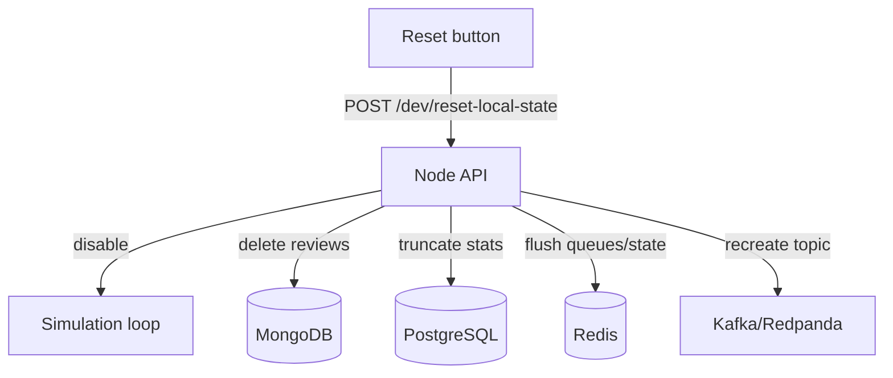
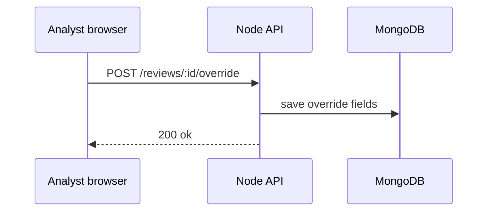
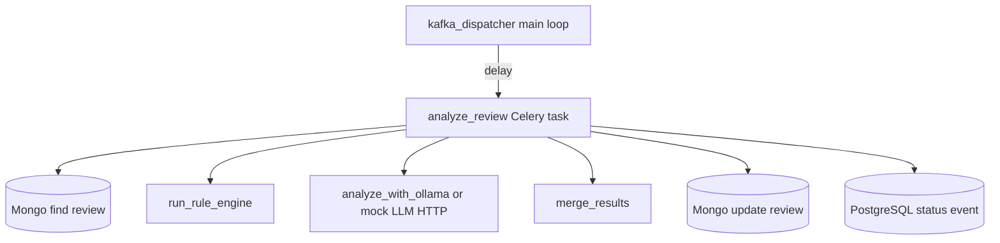

# System handbook (comprehensive)

This document answers “what is this software, why does it exist, how is it structured, and how do requests move through it?” in one place. For a shorter non-technical overview, read [biz_guide_user.md](biz_guide_user.md). For a focused intro to languages, databases, and external services (and why each is used), read [tech_guide_project_stack_intro.md](tech_guide_project_stack_intro.md). For diagrams of every container and data store, read [arch_guide_system_flowchart.md](arch_guide_system_flowchart.md). The doc index is [README.md](README.md).

**Security:** this handbook uses **placeholders** only (URLs, emails like `you@example.com`). Real passwords and API keys live in gitignored `backend/dev.secrets` and `backend/.env` — never copy those values into markdown or chat. See [ops_guide_secrets_management.md](ops_guide_secrets_management.md).

---

## Plain-language purpose

Suspicious Email Triage is a **workbench** for security analysts. It accepts email-like content, stores it as a structured record, runs automated checks asynchronously, and presents an explainable result that humans can accept, reject, or annotate.

The product value is not only automation; it is also **traceability**: overrides and timestamps create an audit story that a client company can use internally after an incident.

---

## The technologies in play (and why they appear)

### React (`frontend/`)

**Role:** browser UI for submission, polling, dashboards, charts, graph, search, logs, ingest controls, and dev-only simulation.

**Why React:** mature ecosystem, component model, and straightforward deployment as static assets behind any CDN or reverse proxy.

### Node.js + Express (`backend/`)

**Role:** primary HTTP API boundary, JWT auth, validation, MongoDB/PostgreSQL/Neo4j/Elasticsearch orchestration, Kafka produce, metrics, centralized log search, verdict delivery, S3 backup ops, and the dev simulation loop.

**Why Node here:** matches many teams’ service stacks, integrates cleanly with MongoDB via Mongoose, and keeps ingestion logic co-located with the API that receives browser traffic.

### Go (`ingest-gateway/`)

**Role:** mailbox webhook edge (`POST /v1/ingest/email`), dev simulation ticks, and forwarding to Node `POST /ingest/internal/mailbox` with a shared secret header.

**Why Go:** small static binary, good fit for a dedicated ingest pod separate from the Node API process.

### Django (`backend/triage_auth/`)

**Role:** optional **Django admin** UI on port **8000** for `auth_users` / role CRUD against the same PostgreSQL tables the Node API uses (sessions stored in SQLite inside the admin container).

**Why Django:** batteries-included admin for operators without building full user CRUD in React.

### Kafka / Redpanda (event bus)

**Role:** durable “something happened” notifications that decouple ingestion from scoring (`email.review.ingested`, dead-letter, completed-review fan-out).

**Why Kafka:** replayability, fan-out, and a clear boundary between “write to DB” and “do expensive work.” Local development uses **Redpanda** in Docker to reduce operational overhead while keeping the client API compatible.

### Celery + Redis (async workers)

**Role:** Python executes the scoring pipeline as background tasks; Redis is the Celery broker/result backend and also holds dev simulation toggle state for Node.

**Why Celery:** standard Python task model, easy horizontal scaling of workers, and isolation from the Node process so heavy libraries do not destabilize the API.

### MongoDB (documents)

**Role:** canonical store for review requests, current processing state, analysis output, overrides, and optional agent traces.

**Why MongoDB:** flexible schema for evolving `analysisResult` structures during experimentation. It is not used as the chart statistics engine, because scanning large review documents for every graph can become wasteful over time.

### PostgreSQL (auth + chart statistics + ingest clients)

**Role:** `auth_users` and RBAC, narrow `review_stats_events` rows for analytics charts, and `ingest_clients` for verdict webhook registration.

**Why PostgreSQL:** charts need compact time-window aggregations; relational indexes fit auth and reporting better than document scans.

### Neo4j (phishing graph)

**Role:** sender, URL, domain, campaign, and review nodes for the **Graph** tab; synced from Celery via Node internal HTTP routes.

### Elasticsearch (review search)

**Role:** denormalized full-text index for the **Search past reviews** tab (`GET /search/reviews`).

### Central logging (append-only file)

**Role:** NDJSON `merged.log` on Docker volume `triage-logs`; Node `GET /logs/search` and the `#logs` tab scan lines (not Elasticsearch). See [ops_guide_central_logging.md](ops_guide_central_logging.md).

---

## External cloud and vendor services (production vs dev mocks)

In **staging/production**, the same application images talk to **real vendor APIs** configured via AWS Secrets Manager bundles and committed env profiles (`backend/.env.staging`, `backend/.env.prod`). In **local dev** (`DEPLOYMENT_ENV=dev`), Docker Compose runs **HTTP mocks** on fixed ports so you can exercise the same code paths without cloud billing.

| Real-world service | Used for | Dev mock (Compose service) | Deep dive |
|--------------------|----------|----------------------------|-----------|
| **AWS Secrets Manager** | JWT keys, DB passwords, ingest tokens at container start | `mock-secrets-manager` (:4566) | [ops_guide_secrets_management.md](ops_guide_secrets_management.md) |
| **Amazon S3** | PostgreSQL logical backup objects | `mock-s3` (:4568) | [ops_guide_s3_backups.md](ops_guide_s3_backups.md) |
| **Snowflake** (or warehouse API) | Analytical export of completed reviews | `mock-snowflake` (:4567) | [data_guide_snowflake_analytics.md](data_guide_snowflake_analytics.md) |
| **OpenAI-compatible LLM** | Commercial single-shot scoring | `mock-llm` (:8090) | [data_guide_mock_llm.md](data_guide_mock_llm.md) |
| **AWS Bedrock / Google Vertex** (Converse-style) | Agent triage FSM | `mock-cloud-llm` (:8091) | [data_guide_agent_triage.md](data_guide_agent_triage.md) |
| **Google OAuth** | Optional browser sign-in | Real Google (configure client id locally) or disabled | [auth_guide_google_oauth.md](auth_guide_google_oauth.md) |
| **Gmail API / Amazon SES / SMTP** | Password-reset and notification email | **Mailpit** (:8025 UI) captures SMTP in dev | [auth_guide_dev_smtp_recovery.md](auth_guide_dev_smtp_recovery.md) |
| **Customer mail platform HTTPS** | Inbound mailbox webhooks | Go `ingest-gateway` + dev simulation | [data_guide_mailbox_ingest_gateway.md](data_guide_mailbox_ingest_gateway.md) |
| **Customer verdict callback URL** | Outbound signed verdict POST | `mock-verdict-callback` (dev test receiver) | [data_guide_verdict_webhooks.md](data_guide_verdict_webhooks.md) |
| **Managed Kafka, RDS, Atlas, OpenSearch, Neo4j Aura, ElastiCache** | Production data plane | Local **mongo**, **postgres**, **redis**, **neo4j**, **redpanda**, **elasticsearch** containers | [stack_guide_staging_production_services.md](stack_guide_staging_production_services.md) |

**Pattern:** application code reads **base URLs and provider flags from environment variables** (`SECRETS_PROVIDER`, `LLM_BASE_URL`, `SNOWFLAKE_URL`, …). Dev aims those variables at mocks; production aims them at real endpoints — no separate fork of business logic. Catalog of mocks: [data_guide_dev_mock_services.md](data_guide_dev_mock_services.md).

---

## Functional modes and use-cases

### UC1 — Analyst triage (primary)

An analyst submits a suspicious email and waits for results.



### UC2 — Manager visibility (analytics)

A manager reviews throughput and backlog health using charts (PostgreSQL `review_stats_events`, not MongoDB scans).



**Auto-refresh** is **on by default**: the browser polls `GET /metrics/timeseries` and `GET /metrics/status-breakdown` every 30 seconds for the rolling last 24 hours, and the **Prefect/dbt** panel on the same tab uses the same interval. Turn auto-refresh off to use a custom From/To window. See [ui_guide_analytics_charts.md](ui_guide_analytics_charts.md).

### UC3 — Engineering validation (dev simulation)

An engineer generates synthetic traffic at a controlled cadence to validate queues and dashboards without manual clicking.



### UC3b — Engineering cleanup (dev reset)

During demos and local development, engineers can reset local state so database and queue sizes do not grow forever.



### UC4 — Audit / dispute handling (override)

An analyst records a human decision with a reason string.



---

## Structure by technology (repository paths)

Paths below are **relative to the repository root**.

### Node.js (`backend/`)

- `backend/src/server.js` — bootstraps Mongo + HTTP listener; hydrates simulation loop after listen.
- `backend/src/http/createApp.js` — Express wiring: middleware, routes, health checks.
- `backend/src/api/reviews.js` — review CRUD, override, and polling endpoints.
- `backend/src/api/metrics.js` — PostgreSQL-backed chart endpoints.
- `backend/src/stats/statsPg.js` — statistics schema, writes, chart queries, dev reset truncation.
- `backend/src/kafka/reviewIngestProducer.js` — KafkaJS producer for ingest events.
- `backend/src/services/reviewPipeline.js` — shared enqueue logic (Kafka + optional BullMQ).
- `backend/src/secrets/secretsProvider.js` — AWS vs mock Secrets Manager abstraction.
- `backend/src/analytics/snowflakeClient.js` — warehouse export HTTP client (mock or real URL).
- `backend/src/backups/s3BackupProvider.js` — S3 backup upload (mock or AWS SDK).
- `backend/src/lib/logSearch.js` — merged.log keyword search for `GET /logs/search`.
- `backend/src/dev/*` — dev-only simulation routes and timer loop.
- `backend/src/worker/*` — optional BullMQ worker (legacy/alternate path).

### React (`frontend/`)

- `frontend/src/TriageApp.jsx` — navigation shell (triage, analytics, graph, search, logs, admin, …).
- `frontend/src/views/AnalyticsView.jsx` — Recharts line/bar charts, auto-refresh, pipeline panel host.
- `frontend/src/components/PipelineOrchestrationPanel.jsx` — Prefect health + dbt daily chart.
- `frontend/src/views/SimulationPanel.jsx` — dev simulation controls and local reset button.
- `frontend/src/views/SearchReviewsView.jsx` — Elasticsearch search tab shell.
- `frontend/src/views/LogsView.jsx` — central log search tab shell.
- `frontend/src/views/AdminView.jsx` — link to Django admin + S3 backup ops panel.
- `frontend/src/hooks/useReviewPoller.js` — polling helper for async review completion.

### Python (`ai_service/`)

- `ai_service/kafka_dispatcher.py` — consumes Kafka messages and dispatches Celery tasks.
- `ai_service/app/celery_app.py` — Celery configuration object.
- `ai_service/app/tasks.py` — `analyze_review` task entrypoint.
- `ai_service/app/rule_engine.py`, `ai_service/app/llm_ollama.py`, `ai_service/app/merge.py` — scoring pipeline pieces.
- `ai_service/app/stats.py` — PostgreSQL status-event writer for charts.
- `ai_service/app/secrets_provider.py` — Python Secrets Manager client (mock or AWS).
- `ai_service/mock_commercial_llm/server.py` — OpenAI-shaped HTTP mock (:8090).
- `ai_service/mock_cloud_llm/server.py` — Bedrock/Vertex-shaped agent mock (:8091).

### Go (`ingest-gateway/`)

- `ingest-gateway/cmd/ingest-gateway/main.go` — HTTP server entrypoint.
- `ingest-gateway/internal/handler/handler.go` — webhook, simulation, metrics routes.

### Django admin (`backend/triage_auth/`)

- `backend/triage_auth/models.py` — unmanaged ORM models mirroring Node-owned PostgreSQL auth tables.
- `backend/triage_auth/backends.py` — email/password authentication for admin login.
- `backend/triage_auth/admin.py` — user/role ModelAdmin (audit log disabled for SQLite FK reasons).

### Docker and infra (`infra/docker/`)

- `infra/docker/docker-compose.yml` — dev stack: databases, mocks, Node, Go, Python workers, Django admin, Mailpit.

### AWS Secrets Manager (production) / `mock-secrets-manager` (dev)

- `backend/src/secrets/secretsProvider.js` — Node `GetSecretValue` client (AWS SDK or mock URL).
- `ai_service/app/secrets_provider.py` — Python equivalent for Celery and dispatcher entrypoints.
- `scripts/docker-entrypoint-with-secrets.sh` — container boot: fetch bundle, export env vars.
- `backend/scripts/preload-secrets.js` — Node preload before `server.js` listens.
- `infra/mock-aws-secrets-manager/server.js` — dev HTTP mock (:4566); reads gitignored `backend/dev.secrets`.

### Amazon S3 (production) / `mock-s3` (dev)

- `backend/src/backups/s3BackupProvider.js` — `PutObject` / list / get for Postgres backup JSON.
- `backend/src/api/ops.js` — `GET/POST /ops/backups/*` routes.
- `backend/src/backups/backupService.js` — logical Postgres snapshot upload orchestration.
- `frontend/src/components/S3BackupsPanel.jsx` — Admin tab backup UI.
- `infra/mock-aws-s3/server.js` — in-memory S3 API mock (:4568).

### Snowflake (production warehouse API) / `mock-snowflake` (dev)

- `backend/src/analytics/snowflakeClient.js` — HTTP client for warehouse insert/report APIs.
- `backend/src/analytics/snowflakeExport.js` — maps completed reviews to export rows.
- `backend/src/api/analytics.js` — `/analytics/*` reporting endpoints.
- `infra/mock-aws-snowflake/server.js` — dev REST mock (:4567).

### OpenAI-compatible LLM (production) / `mock-llm` (dev)

- `ai_service/app/llm_client.py` — `analyze_with_llm`, `analyze_with_mock_commercial` (uses `LLM_BASE_URL`).
- `ai_service/app/tasks.py` — invokes LLM step inside `analyze_review`.
- `ai_service/mock_commercial_llm/server.py` — `POST /v1/chat/completions` mock (:8090).
- `ai_service/mock_commercial_llm/responses.py` — deterministic canned completions.

### AWS Bedrock / Google Vertex (production) / `mock-cloud-llm` (dev)

- `ai_service/app/agent/orchestrator.py` — agent FSM triage loop.
- `ai_service/app/agent/providers/factory.py` — selects Bedrock, Vertex, or mock client.
- `ai_service/app/agent/providers/bedrock_client.py` — boto3 `bedrock-runtime` Converse.
- `ai_service/app/agent/providers/mock_client.py` — HTTP to `MOCK_CLOUD_LLM_URL`.
- `ai_service/mock_cloud_llm/server.py` — Converse-shaped dev mock (:8091).

### Google OAuth (production / optional dev)

- `backend/src/auth/googleLogin.js` — OAuth start/callback, JWT issuance for SPA.
- `backend/src/api/auth.js` — `/auth/google/*`, login, bootstrap reset routes.
- `frontend/src/views/AuthViews.jsx` — email login and Google sign-in link when configured.

### Gmail API / Amazon SES / SMTP (production) / Mailpit (dev)

- `backend/src/auth/email.js` — password-reset message build + transport (SMTP / OAuth mail).
- `infra/docker/docker-compose.yml` — `mailpit` service (:1025 SMTP, :8025 web UI).

### Customer mail platform webhooks (production) / `ingest-gateway` (dev)

- `ingest-gateway/cmd/ingest-gateway/main.go` — Go HTTP server (:8080).
- `ingest-gateway/internal/handler/handler.go` — webhook, simulation, stats handlers.
- `ingest-gateway/internal/backend/client.go` — forwards to Node with `X-Ingest-Internal-Token`.
- `backend/src/api/ingestInternal.js` — `POST /ingest/internal/mailbox`.
- `backend/src/lib/ingestGatewayClient.js` — Node proxy metrics for `#ingest` UI.
- `frontend/src/views/IngestDashboardView.jsx` — ingest simulation and dashboard tab.

### Customer verdict callback (production HTTPS) / `mock-verdict-callback` (dev)

- `backend/src/services/verdictDelivery.js` — signed webhook POST and Kafka fan-out.
- `backend/src/ingest/ingestClientsPg.js` — per-client callback URL registry.
- `backend/src/api/ingestRegister.js`, `backend/src/api/ingestClients.js` — registration APIs.
- `infra/mock-verdict-callback/server.js` — dev receiver for test verdict POSTs.

### Managed data plane (production) / local Docker databases (dev)

- **MongoDB:** `backend/src/models/Review.js`, `backend/src/lib/mongoConnect.js`
- **PostgreSQL:** `backend/src/auth/authPg.js`, `backend/src/stats/statsPg.js`
- **Redis:** `backend/src/dev/simulationStore.js`, Celery broker via `ai_service/app/celery_app.py`
- **Kafka/Redpanda:** `backend/src/kafka/reviewIngestProducer.js`, `ai_service/kafka_dispatcher.py`
- **Neo4j:** `backend/src/graph/neo4jClient.js`, `backend/src/api/graph.js`, `backend/src/api/graphInternal.js`
- **Elasticsearch:** `backend/src/search/elasticClient.js`, `backend/src/search/reviewSearchIndex.js`, `backend/src/api/search.js`, `backend/src/services/reviewSearchSync.js`

---

## Control-flow (function-level) for scoring (Python path)



Optional agent path may call **mock-cloud-llm** or real Bedrock/Vertex when enabled — see [data_guide_agent_triage.md](data_guide_agent_triage.md).

---

## Logging and observability (conceptual)

The API, Python workers, Go gateway, and Django bootstrap write JSON lines into **`merged.log`** (configurable via `MERGED_LOG_PATH`). The Node API exposes keyword/topic/service filtering via `GET /logs/search`; the React **#logs** tab is a plain-language front end for that API (file scan, not Elasticsearch). See [ops_guide_central_logging.md](ops_guide_central_logging.md).

---

## Where this document ends

This handbook is not a substitute for reading code when you are debugging a defect. Treat it as a map: it tells you what the terrain is supposed to look like, but the ground truth is always the repository.

For a full **build and sign-in** walkthrough (including Option C — all mocks), see [stack_guide_build_and_run.md](stack_guide_build_and_run.md).

---

## Command you can run (this guide) {#run-one-command}

<div style="background:#eef1f5;padding:1rem 1.25rem;border-left:4px solid #64748b;margin:1rem 0;border-radius:4px;">

<p><strong>Run in terminal</strong> — WSL, repository root unless noted</p>

```bash
cd ~/suspicious-email-triage
DEPLOYMENT_ENV=dev docker compose -f infra/docker/docker-compose.yml ps mock-secrets-manager mock-snowflake mock-s3 mock-llm mock-cloud-llm mailpit
```

</div>
