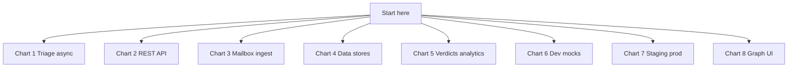
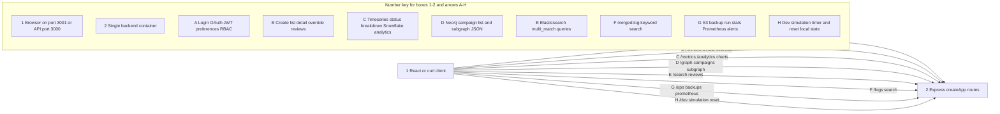
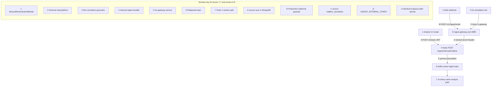
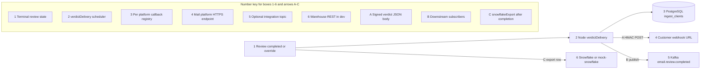
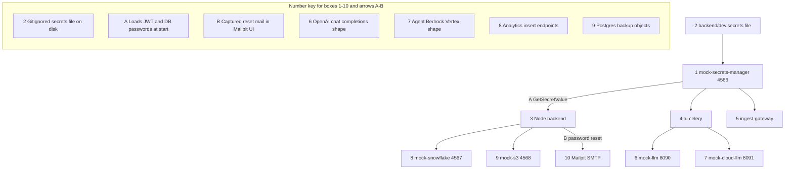
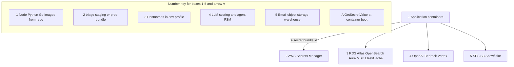

# End-to-end system flowchart

This guide explains the **Suspicious Email Triage** monorepo in **eight partial charts**. Each chart covers one topic. **Numbers on boxes** name components; **letters on arrows** name steps. A **Number key** subgraph at the bottom of each chart explains every label.

For prose detail, see [arch_guide_overview.md](arch_guide_overview.md), [arch_guide_system_comprehensive.md](arch_guide_system_comprehensive.md), and [arch_guide_features_catalog.md](arch_guide_features_catalog.md).

---

## Database and storage inventory

| Store | Type | What it holds | Used by |
|-------|------|---------------|---------|
| **MongoDB** | Document DB | Canonical `Review` documents, `analysisResult`, overrides, optional `agentTrace` | Node API, Celery |
| **PostgreSQL** | Relational DB | `auth_users`, RBAC, `review_stats_events` (charts), `ingest_clients` (verdict webhook registry) | Node API, Celery, Django admin |
| **Neo4j** | Graph DB | Sender, Review, Url, Domain, Campaign nodes and relationships | Node graph APIs; sync from Celery via internal HTTP |
| **Elasticsearch** | Search index | Denormalized review text for keyword search | Node search API; background indexing |
| **Redis** | In-memory | Celery broker/result backend; dev simulation state | Celery, Node dev routes |
| **Redpanda/Kafka** | Event log | `email.review.ingested`, DLQ, `email.review.completed` (verdict fan-out) | Node producer, Python dispatcher |
| **Docker volume `triage-logs`** | Append-only file | `merged.log` NDJSON for central logging and `GET /logs/search` | Node, Python, Go gateway, Django bootstrap |
| **SQLite (Django only)** | Embedded | Django **session** store inside the `django-admin` container | Django admin UI |
| **Snowflake (or mock)** | Cloud warehouse | Analytical copies of completed reviews | Node export after analysis/override |
| **S3 (or mock-s3)** | Object storage | PostgreSQL logical backup JSON snapshots | Node `POST /ops/backups/run` |

**Optional / alternate paths:** legacy **BullMQ** Node worker (`--profile legacy-bullmq`), local **Ollama** LLM when configured, **Prefect/dbt** demo on PostgreSQL ([data_guide_prefect_dbt_demo.md](data_guide_prefect_dbt_demo.md)).

---

## Viewing on Windows 11

| Partial chart | Standalone `.mmd` file |
|---------------|------------------------|
| Overview index | [diagrams/system-flow-main.mmd](diagrams/system-flow-main.mmd) |
| 1 Triage async | [diagrams/system-flow-01-triage-async.mmd](diagrams/system-flow-01-triage-async.mmd) |
| 2 REST API families | [diagrams/system-flow-02-rest-api.mmd](diagrams/system-flow-02-rest-api.mmd) |
| 3 Mailbox ingest | [diagrams/system-flow-03-mailbox-ingest.mmd](diagrams/system-flow-03-mailbox-ingest.mmd) |
| 4 Data stores | [diagrams/system-flow-04-data-stores.mmd](diagrams/system-flow-04-data-stores.mmd) |
| 5 Verdicts and analytics | [diagrams/system-flow-05-verdict-analytics.mmd](diagrams/system-flow-05-verdict-analytics.mmd) |
| 6 Dev mocks | [diagrams/system-flow-06-dev-mocks.mmd](diagrams/system-flow-06-dev-mocks.mmd) |
| 7 Staging / prod | [diagrams/system-flow-staging-prod.mmd](diagrams/system-flow-staging-prod.mmd) |
| 8 Phishing graph UI | [diagrams/system-flow-graph-ui.mmd](diagrams/system-flow-graph-ui.mmd) |

Open any `.mmd` file in [Mermaid Live Editor](https://mermaid.live). For Markdown preview, use one fenced `mermaid` block at a time.

---

## Overview — which chart to open



---

## Chart 1 — Analyst email triage and async scoring

Manual submit through polling and Celery completion. Source: [diagrams/system-flow-01-triage-async.mmd](diagrams/system-flow-01-triage-async.mmd).

```mermaid
flowchart TB
  UI["1 React UI port 3001"]
  API["2 Node Express port 3000"]
  M[(3 MongoDB Review doc)]
  P[(4 PostgreSQL stats event)]
  K["5 Kafka email.review.ingested"]
  D["6 ai-kafka-dispatch"]
  W["7 ai-celery analyze_review"]
  LLM["8 mock-llm or rules engine"]

  UI -->|"A JWT POST /reviews"| API
  API -->|"B insert pending"| M
  API -->|"C review_created row"| P
  API -->|"D publish ingest"| K
  UI -->|"E poll GET /reviews/id"| API
  API -->|"F read status"| M
  K -->|"G consume"| D
  D -->|"H enqueue task"| W
  W -->|"I load and save result"| M
  W -->|"J status_changed row"| P
  W -->|"K optional LLM call"| LLM
  W -->|"L graph and ES sync via Node internal routes"| API

  subgraph legend1 [Number key for boxes 1-8 and arrows A-L]
    direction TB
    L1b["1 React dev server CRA proxy to API"]
    L2b["2 Express handles auth and reviews"]
    L3b["3 MongoDB holds Review lifecycle"]
    L4b["4 PostgreSQL chart events"]
    L5b["5 Kafka decouples ingest from scoring"]
    L6b["6 Python consumer process"]
    L7b["7 Celery worker task"]
    L8b["8 Rules engine and optional LLM HTTP"]
    LA["A Analyst submits email content"]
    LB["B status pending with extracted links"]
    LC["C Analytics pipeline input"]
    LD["D email.review.ingested message"]
    LE["E Hook polls until terminal status"]
    LF["F Returns analysisResult when completed"]
    LG["G Reads ingest topic"]
    LH["H Dispatches analyze_review"]
    LI["I Merges rules and LLM output"]
    LJ["J Live flow and analytics see completion"]
    LK["K mock-llm or agent path when enabled"]
    LL["L POST graph internal sync and ES index upsert"]
  end
```



---

## Chart 2 — REST API families (Node port 3000)

One diagram per **route family** the React UI or scripts call. Source: [diagrams/system-flow-02-rest-api.mmd](diagrams/system-flow-02-rest-api.mmd).



---

## Chart 3 — Mailbox ingest entry paths

Three ways email reaches the **same** Kafka and Celery pipeline. Source: [diagrams/system-flow-03-mailbox-ingest.mmd](diagrams/system-flow-03-mailbox-ingest.mmd).



---

## Chart 4 — Data stores and writers

Which runtime writes each database or log volume. Source: [diagrams/system-flow-04-data-stores.mmd](diagrams/system-flow-04-data-stores.mmd).

```mermaid
flowchart TB
  N["1 Node API"]
  W["2 ai-celery"]
  G["3 ingest-gateway"]
  DJ["4 django-admin"]

  M[(5 MongoDB)]
  PG[(6 PostgreSQL)]
  NEO[(7 Neo4j)]
  ES[(8 Elasticsearch)]
  R[(9 Redis)]
  LOG["10 triage-logs merged.log"]

  N --> M
  N --> PG
  N --> NEO
  N --> ES
  N --> R
  N --> LOG
  W --> M
  W --> PG
  W --> NEO
  W --> ES
  G --> LOG
  DJ --> PG
  DJ --> LOG

  subgraph legend4 [Number key for boxes 1-10]
    direction TB
    L1b["1 Express on port 3000"]
    L2b["2 Python worker container"]
    L3b["3 Go gateway container"]
    L4b["4 Django admin port 8000"]
    L5b["5 Review documents agentTrace"]
    L6b["6 auth stats ingest_clients"]
    L7b["7 Phishing relationship graph"]
    L8b["8 Full text search index"]
    L9b["9 Celery broker dev sim keys"]
    L10b["10 Central NDJSON log volume"]
  end
```



---

## Chart 5 — Outbound verdicts and analytics export

After analysis or override. Source: [diagrams/system-flow-05-verdict-analytics.mmd](diagrams/system-flow-05-verdict-analytics.mmd).



---

## Chart 6 — Dev mocks and startup secrets

Local Docker substitutes for cloud APIs. Source: [diagrams/system-flow-06-dev-mocks.mmd](diagrams/system-flow-06-dev-mocks.mmd).



---

## Chart 7 — Staging and production vendor endpoints

Same containers; environment variables point at managed services. See [stack_guide_staging_production_services.md](stack_guide_staging_production_services.md). Source: [diagrams/system-flow-staging-prod.mmd](diagrams/system-flow-staging-prod.mmd).



---

## Chart 8 — Phishing graph UI

Neo4j data to SVG. See [graph_guide_neo4j_phishing.md](graph_guide_neo4j_phishing.md). Source: [diagrams/system-flow-graph-ui.mmd](diagrams/system-flow-graph-ui.mmd).

```mermaid
flowchart LR
  UI["1 GraphView tab"]
  API["2 Node graph routes"]
  NEO[(3 Neo4j)]
  CAN["4 CampaignGraphCanvas"]
  LAY["5 layoutNodesOnCircle"]
  SVG["6 SVG render"]

  UI -->|"A GET /graph/campaigns"| API
  API -->|"B Cypher read"| NEO
  API -->|"C JSON nodes edges"| CAN
  CAN -->|"D circle x y"| LAY
  LAY --> SVG

  subgraph legend8 [Number key for boxes 1-6 and arrows A-D]
    direction TB
    L1b["1 Phishing graph sub window"]
    L2b["2 graph.read JWT routes"]
    L3b["3 Property graph database"]
    L4b["4 Pan zoom resize component"]
    L5b["5 graphLayout.js"]
    L6b["6 Nodes edges tooltips"]
    LA["A Campaign picker list"]
    LB["B Subgraph for indicator"]
    LC["C Connected component filter"]
    LD["D Circular layout then draw"]
  end
```



---

## Related diagrams elsewhere

| Document | Focus |
|----------|--------|
| [arch_guide_overview.md](arch_guide_overview.md) | Text main flow + sequence diagram |
| [arch_guide_system_comprehensive.md](arch_guide_system_comprehensive.md) | Use cases UC1–UC4 |
| [data_guide_kafka_events.md](data_guide_kafka_events.md) | Topics and consumers |
| [data_guide_agent_triage.md](data_guide_agent_triage.md) | Agent FSM |
| [data_guide_mailbox_ingest_gateway.md](data_guide_mailbox_ingest_gateway.md) | Go gateway |
| [ops_guide_s3_backups.md](ops_guide_s3_backups.md) | S3 backups |

---

## Command you can run (this guide) {#run-one-command}

<div style="background:#eef1f5;padding:1rem 1.25rem;border-left:4px solid #64748b;margin:1rem 0;border-radius:4px;">

<p><strong>Run in terminal</strong> — confirm API + graph path after stack is up</p>

```bash
cd ~/suspicious-email-triage
curl -sS http://localhost:3000/health/live
curl -sS -H "Authorization: Bearer YOUR_JWT" http://localhost:3000/graph/campaigns | python3 -m json.tool | head
```

</div>
