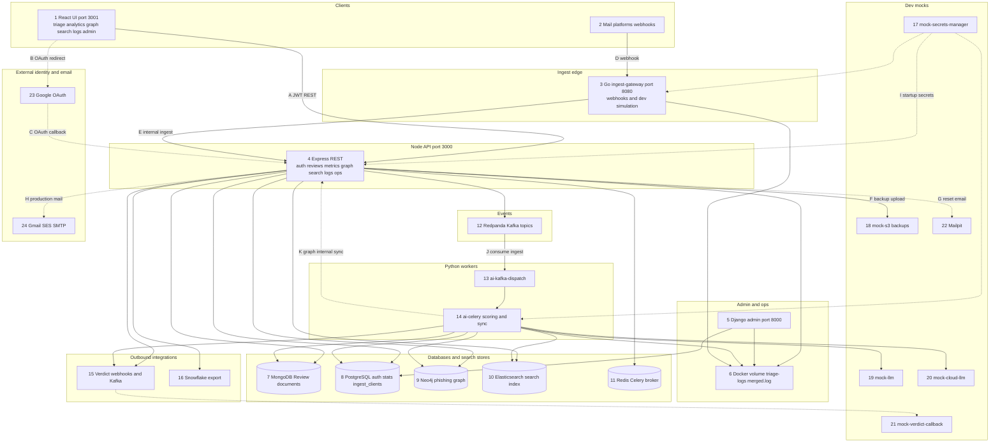
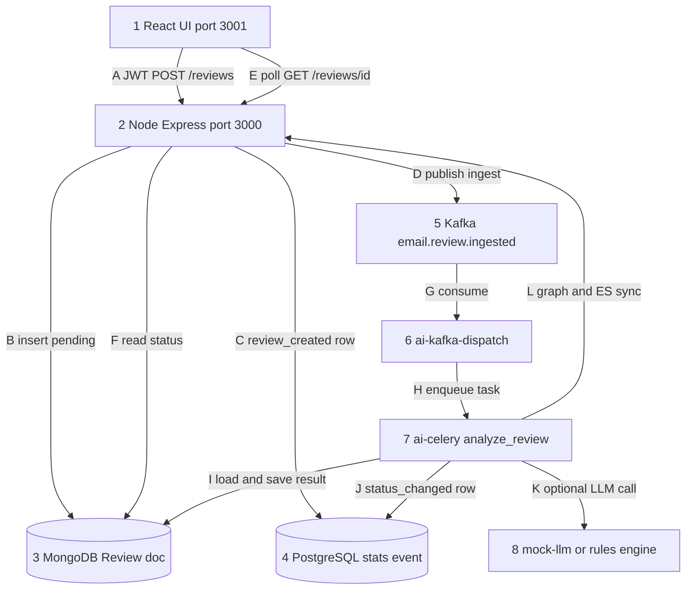
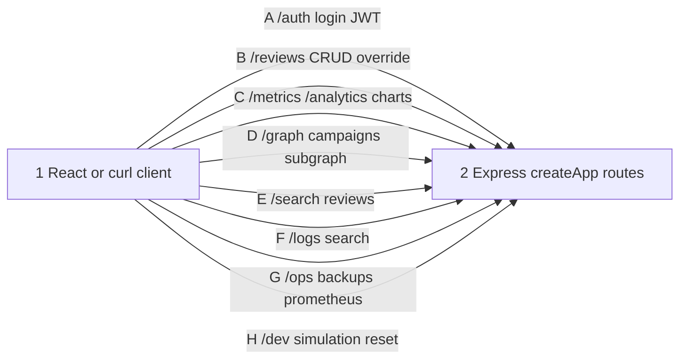
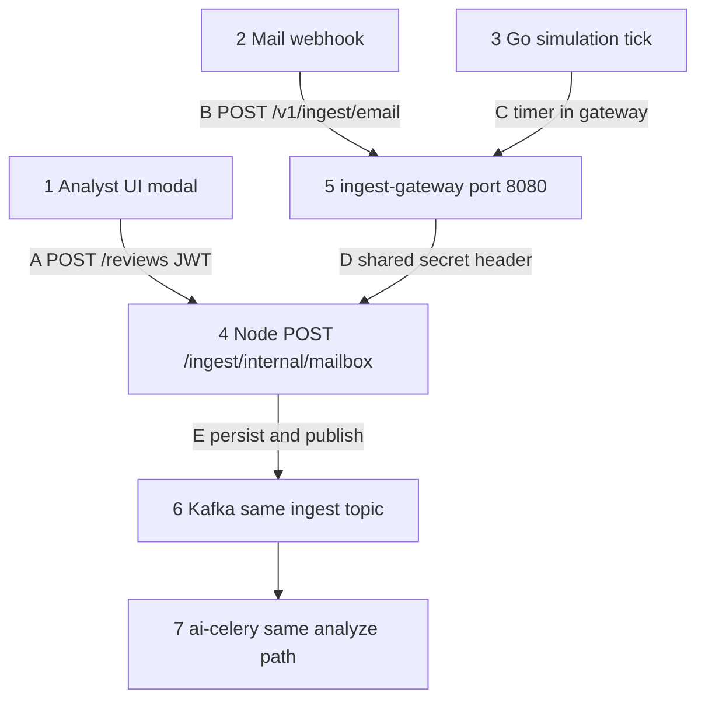
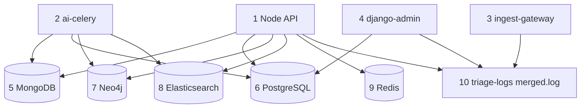
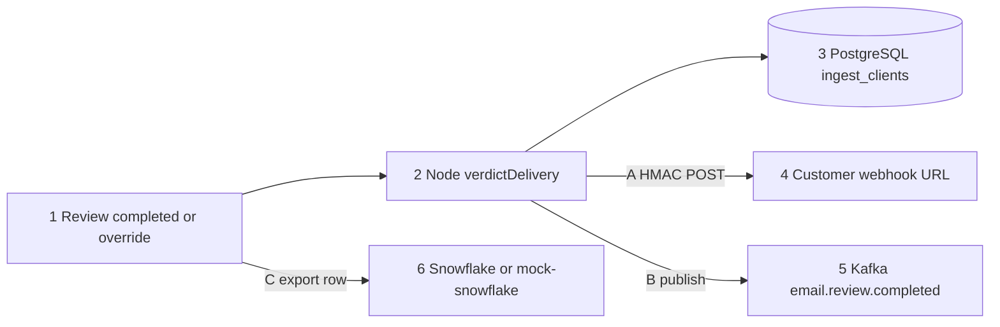
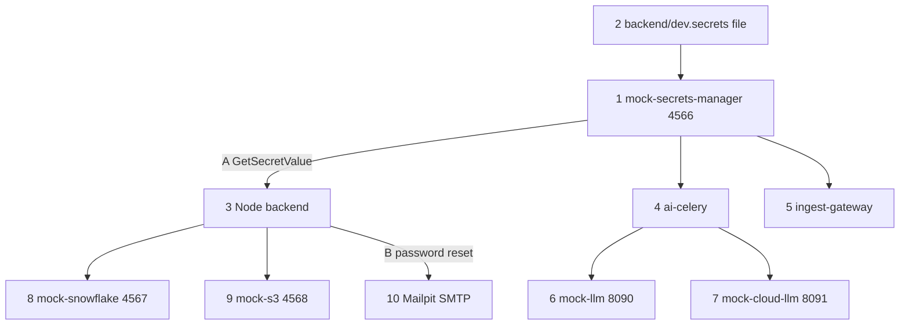
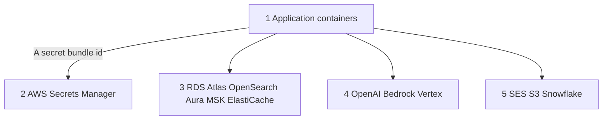
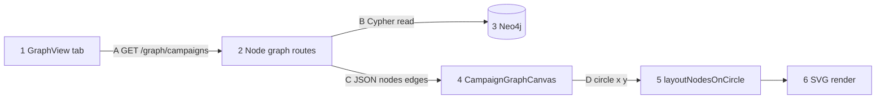

# End-to-end system flowchart

This guide opens with one **overall dev-stack diagram**, then **eight partial diagrams** that zoom into one topic each. Numbers on shapes and letters on arrows match the **numbered lists directly under each diagram**.

For prose detail, see [arch_guide_overview.md](arch_guide_overview.md), [arch_guide_system_comprehensive.md](arch_guide_system_comprehensive.md), and [arch_guide_features_catalog.md](arch_guide_features_catalog.md).

---

## Database and storage inventory

| Store | Type | What it holds | Used by |
|-------|------|---------------|---------|
| **MongoDB** | Document DB | Canonical `Review` documents, `analysisResult`, overrides, optional `agentTrace` | Node API, Celery |
| **PostgreSQL** | Relational DB | `auth_users`, RBAC, `review_stats_events` (charts), `ingest_clients` (verdict webhook registry) | Node API, Celery, Django admin |
| **Neo4j** | Graph DB | Sender, Review, Url, Domain, Campaign nodes and relationships | Node graph APIs; sync from Celery via internal HTTP |
| **Elasticsearch** | Search index | Denormalized review text for keyword search | Node search API; background indexing |
| **Redis** | In-memory | Celery broker/result backend; dev simulation state | Celery, Node dev routes |
| **Redpanda/Kafka** | Event log | `email.review.ingested`, DLQ, `email.review.completed` (verdict fan-out) | Node producer, Python dispatcher |
| **Docker volume `triage-logs`** | Append-only file | `merged.log` NDJSON for central logging and `GET /logs/search` | Node, Python, Go gateway, Django bootstrap |
| **SQLite (Django only)** | Embedded | Django **session** store inside the `django-admin` container | Django admin UI |
| **Snowflake (or mock)** | Cloud warehouse | Analytical copies of completed reviews | Node export after analysis/override |
| **S3 (or mock-s3)** | Object storage | PostgreSQL logical backup JSON snapshots | Node `POST /ops/backups/run` |

**Optional / alternate paths:** legacy **BullMQ** Node worker (`--profile legacy-bullmq`), local **Ollama** LLM when configured, **Prefect/dbt** demo on PostgreSQL ([data_guide_prefect_dbt_demo.md](data_guide_prefect_dbt_demo.md)).

---

## Viewing on Windows 11

| Diagram | Standalone `.mmd` file |
|---------|-------------------------|
| **Overall dev stack** | [diagrams/system-flow-main.mmd](diagrams/system-flow-main.mmd) |
| Partial chart 1–6 | [diagrams/system-flow-01-triage-async.mmd](diagrams/system-flow-01-triage-async.mmd) … [06](diagrams/system-flow-06-dev-mocks.mmd) |
| Partial chart 7 staging/prod | [diagrams/system-flow-staging-prod.mmd](diagrams/system-flow-staging-prod.mmd) |
| Partial chart 8 graph UI | [diagrams/system-flow-graph-ui.mmd](diagrams/system-flow-graph-ui.mmd) |

Open any `.mmd` file in [Mermaid Live Editor](https://mermaid.live). In Markdown preview, render one fenced `mermaid` block at a time if the page feels slow.

---

## Overall whole-project flow — dev stack (Docker Compose)

Same source as [diagrams/system-flow-main.mmd](diagrams/system-flow-main.mmd).



**What the numbered boxes mean**

1. React UI on port 3001 — Create React App dev server; proxies API calls to Node on port 3000.
2. External mail platforms that POST mailbox events (production-style path).
3. Go **ingest-gateway** — webhook edge and dev simulation ticks; forwards to Node with a shared secret.
4. Node **Express** API — main REST surface for the SPA, scripts, and internal worker callbacks.
5. **Django admin** on port 8000 — optional user/role CRUD against PostgreSQL auth tables.
6. Shared **triage-logs** volume — append-only `merged.log` for unified log search.
7. **MongoDB** — canonical review documents and analysis output.
8. **PostgreSQL** — login/RBAC, analytics event rows, ingest client registry for verdict webhooks.
9. **Neo4j** — phishing relationship graph (senders, URLs, campaigns).
10. **Elasticsearch** — full-text search index for the Search tab.
11. **Redis** — Celery broker and dev-only simulation state.
12. **Kafka/Redpanda** — ingest, dead-letter, and completed-review topics.
13. **ai-kafka-dispatch** — Python consumer that enqueues Celery work.
14. **ai-celery** — scoring pipeline, graph/search side effects, optional LLM/agent calls.
15. **Verdict delivery** — HTTPS callbacks and optional Kafka fan-out to mail platforms.
16. **Snowflake export** — analytical copy of completed reviews (mock HTTP warehouse in dev).
17. **mock-secrets-manager** — serves gitignored `dev.secrets` at container startup.
18. **mock-s3** — local object storage for Postgres backup uploads.
19. **mock-llm** — OpenAI-shaped HTTP server for commercial LLM scoring in dev.
20. **mock-cloud-llm** — Bedrock/Vertex-shaped HTTP server for agent triage in dev.
21. **mock-verdict-callback** — receives test verdict POSTs in dev.
22. **Mailpit** — captures password-reset email in dev.
23. **Google OAuth** — optional browser sign-in flow.
24. **Gmail API, Amazon SES, or SMTP** — outbound mail in configured environments.

**What the lettered arrows mean**

- **A** — Browser calls Node with a JWT after login (triage, charts, graph, search, logs, ops).
- **B / C** — Optional Google OAuth redirect and callback that ends in a JWT for the SPA.
- **D** — Mail provider hits the Go gateway webhook endpoint.
- **E** — Gateway forwards normalized payload to Node internal mailbox ingest.
- **F** — Admin backup job uploads a snapshot to S3 (mock bucket in dev).
- **G** — Password-reset messages go to Mailpit in dev.
- **H** — Production/staging email delivery when Mailpit is bypassed.
- **I** — Containers fetch secrets (JWT key, DB passwords, tokens) before serving traffic.
- **J** — Dispatcher reads `email.review.ingested` and schedules Celery tasks.
- **K** — Celery invokes Node internal routes to sync Neo4j and Elasticsearch after scoring.

The partial charts below explain each area in more step-by-step detail.

---

## Partial chart 1 — Analyst email triage and async scoring

Source: [diagrams/system-flow-01-triage-async.mmd](diagrams/system-flow-01-triage-async.mmd).



**Comments**

1. React triage UI where the analyst pastes or submits suspicious email content.
2. Node API validates JWT permissions and accepts `POST /reviews`.
3. MongoDB stores the new `Review` with status `pending` and extracted links.
4. PostgreSQL receives a compact `review_created` event for analytics charts.
5. Kafka topic `email.review.ingested` carries the handoff to Python workers.
6. Long-running Python process that subscribes to the ingest topic.
7. Celery worker that runs the `analyze_review` task.
8. Rule engine inside the worker, plus optional HTTP call to mock-llm or agent LLM when enabled.

- **A** — Authenticated submit from the dashboard or modal.
- **B** — Persist pending review document.
- **C** — Record chart-friendly statistics without scanning Mongo later.
- **D** — Publish durable event so scoring can scale separately from HTTP.
- **E** — UI polling loop until status becomes `completed` or `failed`.
- **F** — API returns current `analysisResult` when ready.
- **G** — Dispatcher pulls the next ingest message.
- **H** — Task queued on Redis for Celery workers.
- **I** — Worker writes merged verdict, findings, and final status to MongoDB.
- **J** — Worker inserts status-change row for Live flow and Analytics.
- **K** — Optional LLM HTTP request when `DISABLE_LLM=false` or agent mode is on.
- **L** — Worker calls Node internal endpoints to refresh Neo4j and Elasticsearch.

---

## Partial chart 2 — REST API families (Node port 3000)

Source: [diagrams/system-flow-02-rest-api.mmd](diagrams/system-flow-02-rest-api.mmd).



**Comments**

1. Browser on port 3001 (dev proxy) or any HTTP client with a bearer token on port 3000.
2. Single Express application registered in `createApp.js` — all routes share JWT middleware where required.

- **A** — Login, OAuth callback handling, preferences, password reset (`/auth/*`).
- **B** — Create/list/detail reviews and analyst override (`/reviews/*`).
- **C** — PostgreSQL-backed timeseries and Snowflake analytics APIs (`/metrics/*`, `/analytics/*`).
- **D** — Neo4j-backed campaign list and subgraph JSON (`/graph/*`).
- **E** — Elasticsearch queries over indexed reviews (`/search/*`).
- **F** — Keyword search in shared `merged.log` (`/logs/search`).
- **G** — S3 backups, Prometheus text, alert evaluation (`/ops/*`).
- **H** — Dev-only simulation timer and `reset-local-state` (`/dev/*`).

---

## Partial chart 3 — Mailbox ingest entry paths

Source: [diagrams/system-flow-03-mailbox-ingest.mmd](diagrams/system-flow-03-mailbox-ingest.mmd).



**Comments**

1. Manual **Submit email** modal — same pipeline as typing in the triage form (`source: user`).
2. Real or test mail platform POSTing JSON to the Go gateway in production-style setups.
3. Dev **simulation** goroutine inside ingest-gateway (`source: mailbox_simulation`).
4. Node internal route that validates `INGEST_INTERNAL_TOKEN` and normalizes payload.
5. Go service exposing webhook, metrics, and simulation control on port 8080.
6. Same Kafka ingest topic used by manual reviews — one async pipeline for all sources.
7. Celery scoring path described in partial chart 1.

- **A** — Standard analyst JWT path (does not require the gateway).
- **B** — External webhook hits Go, not Node directly.
- **C** — Simulation tick builds synthetic email and calls the same Node client as webhooks.
- **D** — Header-protected internal HTTP between Go and Node.
- **E** — Mongo persist plus Kafka publish — identical enqueue semantics for every path.

---

## Partial chart 4 — Data stores and writers

Source: [diagrams/system-flow-04-data-stores.mmd](diagrams/system-flow-04-data-stores.mmd).



**Comments**

1. Node API — creates reviews, serves queries, syncs graph/search on ingest and override.
2. Celery worker — completes analysis, updates Mongo/Postgres, triggers graph/search callbacks.
3. Go gateway — appends structured log lines for mailbox ingest and simulation.
4. Django admin — reads/writes PostgreSQL auth tables; logs bootstrap actions.

5. MongoDB — full review documents and optional agent trace audit fields.
6. PostgreSQL — users, roles, chart events, ingest client registry.
7. Neo4j — phishing entities and relationships for the Graph tab.
8. Elasticsearch — search index documents derived from reviews.
9. Redis — Celery broker and dev simulation keys.
10. Central NDJSON log file on the shared Docker volume.

---

## Partial chart 5 — Outbound verdicts and analytics export

Source: [diagrams/system-flow-05-verdict-analytics.mmd](diagrams/system-flow-05-verdict-analytics.mmd).



**Comments**

1. Trigger moment — automated analysis finished or analyst saved an override.
2. Node service that schedules delivery jobs and reads client configuration.
3. PostgreSQL `ingest_clients` — default callback URL, secrets, and `ingestClientId` mapping.
4. Customer mail platform HTTPS endpoint that receives signed verdict JSON.
5. Kafka topic for integrations that prefer event streaming over webhooks.
6. Analytical warehouse row export (mock REST server in dev).

- **A** — Signed POST with verdict payload to the registered webhook URL.
- **B** — Optional message on `email.review.completed` for subscribers.
- **C** — Async export mapper sends row to Snowflake API after completion.

---

## Partial chart 6 — Dev mocks and startup secrets

Source: [diagrams/system-flow-06-dev-mocks.mmd](diagrams/system-flow-06-dev-mocks.mmd).



**Comments**

1. HTTP service mimicking AWS Secrets Manager `GetSecretValue` on port 4566.
2. Gitignored local file edited from `dev.secrets.example` — passwords never committed.
3. Node backend container — loads secrets at boot via entrypoint.
4. Celery worker container — same secret bundle for DB and LLM URLs.
5. Go gateway container — reads ingest tokens from the same bundle.
6. OpenAI-compatible mock for single-shot commercial LLM scoring.
7. Separate mock for agent FSM cloud LLM (Bedrock/Vertex response shape).
8. In-memory Snowflake-style analytics REST.
9. Local S3 API for Postgres backup objects.
10. Mailpit captures SMTP from password-reset flow in dev.

- **A** — Entrypoint HTTP fetch injects env vars before processes listen on ports.
- **B** — Reset email routed to Mailpit web UI instead of the public internet.

---

## Partial chart 7 — Staging and production vendor endpoints

See [stack_guide_staging_production_services.md](stack_guide_staging_production_services.md). Source: [diagrams/system-flow-staging-prod.mmd](diagrams/system-flow-staging-prod.mmd).



**Comments**

1. Same Node, Python, and Go images built from this repository — only configuration changes.
2. AWS Secrets Manager holds `triage/staging` or `triage/prod` JSON bundles.
3. Managed data plane — PostgreSQL, MongoDB, OpenSearch/Elastic, Neo4j Aura, Kafka, Redis endpoints from env profiles.
4. Commercial LLM vendors for scoring and agent triage (OpenAI-compatible APIs, Bedrock Converse, Vertex Gemini).
5. Outbound email (SES), backup buckets (S3), and Snowflake warehouse URLs.

- **A** — Containers call `GetSecretValue` with IAM roles instead of the dev mock on port 4566.

---

## Partial chart 8 — Phishing graph UI

See [graph_guide_neo4j_phishing.md](graph_guide_neo4j_phishing.md). Source: [diagrams/system-flow-graph-ui.mmd](diagrams/system-flow-graph-ui.mmd).



**Comments**

1. **Phishing graph** sub-window in the React app (`GraphView.jsx`).
2. Express routes protected by `graph.read` permission.
3. Neo4j stores campaigns, senders, reviews, URLs, and domains.
4. React component that draws one campaign subgraph with pan, zoom, and resize.
5. Pure JavaScript helper that places nodes on a circle (`graphLayout.js`).
6. SVG output with tooltips and hover highlighting.

- **A** — UI loads campaign list sorted by linked review count.
- **B** — API runs Cypher for the selected campaign indicator.
- **C** — JSON nodes/edges returned to the browser.
- **D** — Layout assigns x/y coordinates before drawing edges and labels.

---

## Related diagrams elsewhere

| Document | Focus |
|----------|--------|
| [arch_guide_overview.md](arch_guide_overview.md) | Text main flow + sequence diagram |
| [arch_guide_system_comprehensive.md](arch_guide_system_comprehensive.md) | Use cases UC1–UC4 |
| [data_guide_kafka_events.md](data_guide_kafka_events.md) | Topics and consumers |
| [data_guide_agent_triage.md](data_guide_agent_triage.md) | Agent FSM |
| [data_guide_mailbox_ingest_gateway.md](data_guide_mailbox_ingest_gateway.md) | Go gateway |
| [ops_guide_s3_backups.md](ops_guide_s3_backups.md) | S3 backups |

---

## Command you can run (this guide) {#run-one-command}

<div style="background:#eef1f5;padding:1rem 1.25rem;border-left:4px solid #64748b;margin:1rem 0;border-radius:4px;">

<p><strong>Run in terminal</strong> — confirm API + graph path after stack is up</p>

```bash
cd ~/suspicious-email-triage
curl -sS http://localhost:3000/health/live
curl -sS -H "Authorization: Bearer YOUR_JWT" http://localhost:3000/graph/campaigns | python3 -m json.tool | head
```

</div>
