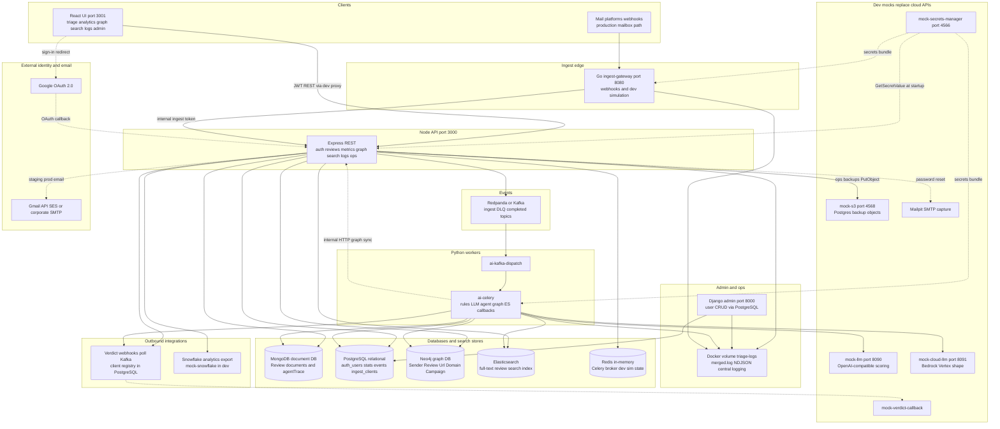
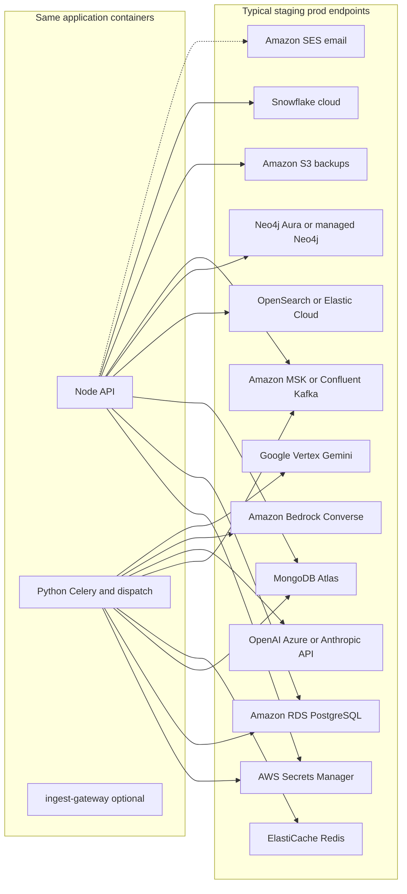
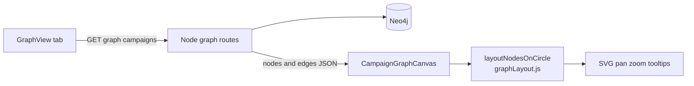

# End-to-end system flowchart

One-page map of how the **Suspicious Email Triage** monorepo fits together. It lists **every major database**, **dev mocks**, and **staging/prod cloud counterparts**. For narrative detail, see [arch_guide_overview.md](arch_guide_overview.md), [arch_guide_system_comprehensive.md](arch_guide_system_comprehensive.md), and [arch_guide_features_catalog.md](arch_guide_features_catalog.md).

---

## Database and storage inventory

This project uses **several store types**; each has a distinct job. **Phishing graph data is not stored in a column-oriented database** (no Cassandra, ClickHouse, or Bigtable). Campaign relationships live in **Neo4j**, a **labeled property graph database** (nodes + relationships, queried with Cypher).

| Store | Type | What it holds | Used by |
|-------|------|---------------|---------|
| **MongoDB** | Document DB | Canonical `Review` documents, `analysisResult`, overrides, optional `agentTrace` | Node API, Celery |
| **PostgreSQL** | Relational DB | `auth_users`, RBAC, `review_stats_events` (charts), `ingest_clients` (verdict webhook registry) | Node API, Celery, Django admin |
| **Neo4j** | **Graph DB** | Sender, Review, Url, Domain, Campaign nodes and relationships | Node graph APIs; sync from Celery via internal HTTP |
| **Elasticsearch** | Search index | Denormalized review text for keyword search | Node search API; background indexing |
| **Redis** | In-memory | Celery broker/result backend; dev simulation state | Celery, Node dev routes |
| **Redpanda/Kafka** | Event log | `email.review.ingested`, DLQ, `email.review.completed` (verdict fan-out) | Node producer, Python dispatcher |
| **Docker volume `triage-logs`** | Append-only file | `merged.log` NDJSON (central logging, not a query DB) | Node, Python, Go gateway, Django bootstrap |
| **SQLite (Django only)** | Embedded | Django **session** store inside `django-admin` container only — not application data | Django admin UI |
| **Snowflake (or mock)** | Cloud warehouse | Analytical copies of completed reviews | Node export after analysis/override |
| **S3 (or mock-s3)** | Object storage | PostgreSQL logical backup JSON snapshots | Node `POST /ops/backups/run` |

**Optional / alternate paths (not in the main diagram):** legacy **BullMQ** Node worker (`--profile legacy-bullmq`), local **Ollama** LLM if configured, **Prefect/dbt** demo reads PostgreSQL only ([data_guide_prefect_dbt_demo.md](data_guide_prefect_dbt_demo.md)).

Deep dives: [graph_guide_neo4j_phishing.md](graph_guide_neo4j_phishing.md), [stack_guide_staging_production_services.md](stack_guide_staging_production_services.md), [data_guide_dev_mock_services.md](data_guide_dev_mock_services.md).

---

## Viewing on Windows 11

| What works | How |
|------------|-----|
| **Standalone source (recommended)** | Open **`docs/diagrams/system-flow-main.mmd`** in [Mermaid Live Editor](https://mermaid.live). |
| **Staging/prod cloud map** | Open **`docs/diagrams/system-flow-staging-prod.mmd`**. |
| **Graph UI only** | Open **`docs/diagrams/system-flow-graph-ui.mmd`**. |
| **Markdown preview** | **Markdown Preview Mermaid Support** → preview this file. |

Copy **only** the contents of a ` ```mermaid ` block (or a `.mmd` file), not the whole markdown page, into Mermaid Live Editor if preview fails.

---

## Whole-project flow — dev stack (default Docker Compose)

Same diagram as [diagrams/system-flow-main.mmd](diagrams/system-flow-main.mmd).



**How to read this diagram**

| Arrow | Meaning |
|-------|---------|
| Browser → Node | Primary path: triage, polling, analytics, Neo4j graph API, Elasticsearch search, unified logs, ops backups. |
| Mail → Go gateway → Node | Mailbox ingest and dev simulation share Node internal persist → Kafka pipeline. |
| Node / Celery → Neo4j | **Graph storage** — property graph, not columns or Mongo embeds. |
| Node / Celery → Elasticsearch | Search index separate from Neo4j graph traversals. |
| mock-secrets-manager | In dev, all containers load JWT/DB passwords from gitignored `dev.secrets` via HTTP GetSecretValue shape. |
| mock-s3 | Dev stand-in for **Amazon S3** backup bucket ([ops_guide_s3_backups.md](ops_guide_s3_backups.md)). |
| Verdict / Snowflake | Outbound integrations; registry in PostgreSQL; dev uses mock containers. |

---

## Staging and production — real cloud services

In **dev**, the `devMocks` boxes above replace paid APIs. In **staging/prod**, the same env vars point at real vendors (no code fork). See [stack_guide_staging_production_services.md](stack_guide_staging_production_services.md).

Standalone diagram: [diagrams/system-flow-staging-prod.mmd](diagrams/system-flow-staging-prod.mmd).



---

## Phishing graph UI (where `layoutNodesOnCircle` fits)

Analyst opens **Phishing graph** → Node reads **Neo4j** → JSON nodes/edges → React `GraphView` → `CampaignGraphCanvas` → `layoutNodesOnCircle` → SVG. See [graph_guide_neo4j_phishing.md](graph_guide_neo4j_phishing.md).

Standalone file: [diagrams/system-flow-graph-ui.mmd](diagrams/system-flow-graph-ui.mmd).



---

## Related diagrams elsewhere

| Document | Focus |
|----------|--------|
| [arch_guide_overview.md](arch_guide_overview.md) | Text main flow + sequence diagram |
| [arch_guide_system_comprehensive.md](arch_guide_system_comprehensive.md) | Use cases UC1–UC4, Python scoring |
| [data_guide_kafka_events.md](data_guide_kafka_events.md) | Topics, DLQ, completed events |
| [data_guide_agent_triage.md](data_guide_agent_triage.md) | Agent FSM + Bedrock/Vertex/mock |
| [data_guide_mailbox_ingest_gateway.md](data_guide_mailbox_ingest_gateway.md) | Go gateway |
| [ops_guide_s3_backups.md](ops_guide_s3_backups.md) | S3 backup flow |

---

## Command you can run (this guide) {#run-one-command}

<div style="background:#eef1f5;padding:1rem 1.25rem;border-left:4px solid #64748b;margin:1rem 0;border-radius:4px;">

<p><strong>Run in terminal</strong> — confirm API + graph path after stack is up</p>

```bash
cd ~/suspicious-email-triage
curl -sS http://localhost:3000/health/live
curl -sS -H "Authorization: Bearer YOUR_JWT" http://localhost:3000/graph/campaigns | python3 -m json.tool | head
```

</div>
