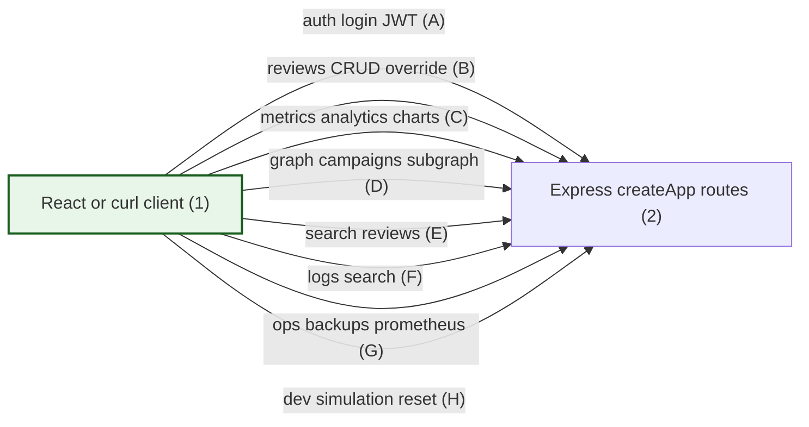
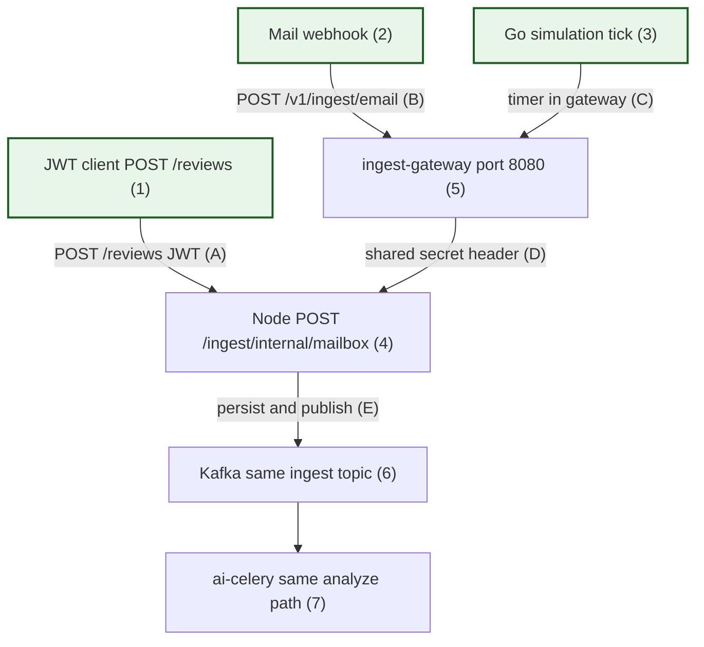
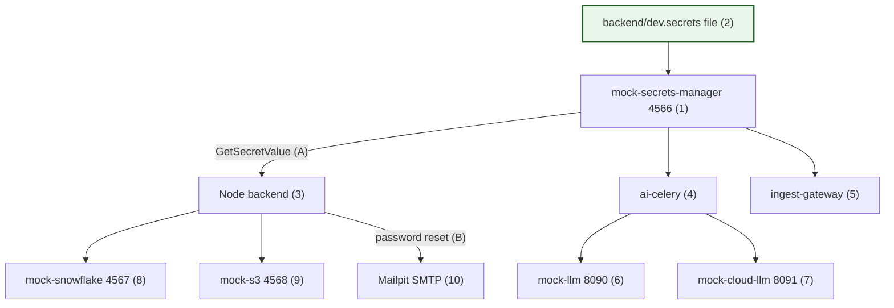
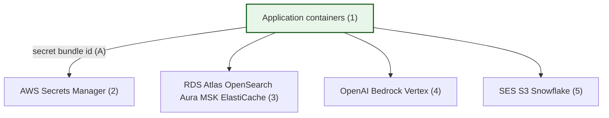

# End-to-end system flowchart

This guide opens with one **overall dev-stack diagram**, then **eight partial diagrams** that zoom into one topic each. Numbers on shapes and letters on arrows match the **numbered lists directly under each diagram**.

For prose detail, see [arch_guide_overview.md](arch_guide_overview.md), [arch_guide_system_comprehensive.md](arch_guide_system_comprehensive.md), and [arch_guide_features_catalog.md](arch_guide_features_catalog.md).

---

## Database and storage inventory

| Store | Type | What it holds | Used by |
|-------|------|---------------|---------|
| **MongoDB** | Document DB | Canonical `Review` documents, `analysisResult`, overrides, optional `agentTrace` | Node API, Celery |
| **PostgreSQL** | Relational DB | `auth_users`, RBAC, `review_stats_events` (charts), `ingest_clients` (verdict webhook registry) | Node API, Celery, Django admin |
| **Neo4j** | Graph DB | Sender, Review, Url, Domain, Campaign nodes and relationships | Node graph APIs; sync from Celery via internal HTTP |
| **Elasticsearch** | Search index | Denormalized review text for keyword search | Node search API; background indexing |
| **Redis** | In-memory | Celery broker/result backend; dev simulation state | Celery, Node dev routes |
| **Redpanda/Kafka** | Event log | `email.review.ingested`, DLQ, `email.review.completed` (verdict fan-out) | Node producer, Python dispatcher |
| **Docker volume `triage-logs`** | Append-only file | `merged.log` NDJSON for central logging and `GET /logs/search` | Node, Python, Go gateway, Django bootstrap |
| **SQLite (Django only)** | Embedded | Django **session** store inside the `django-admin` container | Django admin UI |
| **Snowflake (or mock)** | Cloud warehouse | Analytical copies of completed reviews | Node export after analysis/override |
| **S3 (or mock-s3)** | Object storage | PostgreSQL logical backup JSON snapshots | Node `POST /ops/backups/run` |

**Optional / alternate paths:** legacy **BullMQ** Node worker (`--profile legacy-bullmq`), local **Ollama** LLM when configured, **Prefect/dbt** demo on PostgreSQL ([data_guide_prefect_dbt_demo.md](data_guide_prefect_dbt_demo.md)).

---

## Viewing on Windows 11

| Diagram | Standalone `.mmd` file |
|---------|-------------------------|
| **Overall dev stack** | [diagrams/system-flow-main.mmd](diagrams/system-flow-main.mmd) |
| Partial chart 1–6 | [diagrams/system-flow-01-triage-async.mmd](diagrams/system-flow-01-triage-async.mmd) … [06](diagrams/system-flow-06-dev-mocks.mmd) |
| Partial chart 7 staging/prod | [diagrams/system-flow-staging-prod.mmd](diagrams/system-flow-staging-prod.mmd) |
| Partial chart 8 graph UI | [diagrams/system-flow-graph-ui.mmd](diagrams/system-flow-graph-ui.mmd) |

Open any `.mmd` file in [Mermaid Live Editor](https://mermaid.live). In Markdown preview, render one fenced `mermaid` block at a time if the page feels slow.

**Diagram conventions:** Solid arrows (`-->`) and dashed arrows (`-.->`) both end in an **arrowhead** at the destination. **Green-bordered boxes** (`flowEntry` style) mark where a flow **starts** (human or external trigger). Two-way relationships use separate one-way arrows when both directions matter (for example OAuth redirect out, callback back).

---

## Overall whole-project flow — dev stack (Docker Compose)

Same source as [diagrams/system-flow-main.mmd](diagrams/system-flow-main.mmd).

This diagram shows every major container group in the default **dev** Docker Compose stack and how traffic moves between them: analysts and mail platforms on the left, Node and Go services in the middle, databases and Kafka in the center, Python workers on the right, plus dev mocks and optional external OAuth/email at the edges.

```mermaid
flowchart TB
  classDef flowEntry fill:#e8f5e9,stroke:#1b5e20,stroke-width:2px

  subgraph clients [Clients]
    BROWSER["React UI port 3001 (1)<br/>triage analytics graph search logs admin"]
    MAIL["Mail platforms webhooks (2)"]
  end

  subgraph edge [Ingest edge]
    GW["Go ingest-gateway port 8080 (3)<br/>webhooks and dev simulation"]
  end

  subgraph nodeApi [Node API port 3000]
    EXPRESS["Express REST (4)<br/>auth reviews metrics graph search logs ops"]
  end

  subgraph adminOps [Admin and ops]
    DJANGO["Django admin port 8000 (5)"]
    LOGVOL["Docker volume triage-logs merged.log (6)"]
  end

  subgraph data [Databases and search stores]
    MONGO[(MongoDB Review documents (7))]
    PG[(PostgreSQL auth stats ingest_clients (8))]
    NEO[(Neo4j phishing graph (9))]
    ES[(Elasticsearch search index (10))]
    REDIS[(Redis Celery broker (11))]
  end

  subgraph events [Events]
    KAFKA["Redpanda Kafka topics (12)"]
  end

  subgraph workers [Python workers]
    DISPATCH["ai-kafka-dispatch (13)"]
    CELERY["ai-celery scoring and sync (14)"]
  end

  subgraph outbound [Outbound integrations]
    VERDICT["Verdict webhooks and Kafka (15)"]
    SNOW["Snowflake export (16)"]
  end

  subgraph devMocks [Dev mocks]
    MOCKSECR["mock-secrets-manager (17)"]
    MOCKS3["mock-s3 backups (18)"]
    MOCKLLM["mock-llm (19)"]
    MOCKAGENT["mock-cloud-llm (20)"]
    MOCKCB["mock-verdict-callback (21)"]
    MAILPIT["Mailpit (22)"]
  end

  subgraph externalId [External identity and email]
    GOOGLE["Google OAuth (23)"]
    EMAILVENDOR["Gmail SES SMTP (24)"]
  end

  BROWSER -->|JWT REST (A)| EXPRESS
  BROWSER -.->|OAuth redirect (B)| GOOGLE
  GOOGLE -.->|OAuth callback (C)| EXPRESS
  MAIL -->|webhook (D)| GW
  GW -->|internal ingest (E)| EXPRESS

  EXPRESS --> MONGO
  EXPRESS --> PG
  EXPRESS --> NEO
  EXPRESS --> ES
  EXPRESS --> REDIS
  EXPRESS --> KAFKA
  EXPRESS --> VERDICT
  EXPRESS --> SNOW
  EXPRESS --> LOGVOL
  EXPRESS -->|backup upload (F)| MOCKS3
  EXPRESS -.->|reset email (G)| MAILPIT
  EXPRESS -.->|production mail (H)| EMAILVENDOR

  DJANGO --> PG
  DJANGO --> LOGVOL

  MOCKSECR -.->|startup secrets (I)| EXPRESS
  MOCKSECR -.-> CELERY
  MOCKSECR -.-> GW

  KAFKA -->|consume ingest (J)| DISPATCH
  DISPATCH --> CELERY
  CELERY --> MONGO
  CELERY --> PG
  CELERY --> MOCKLLM
  CELERY --> MOCKAGENT
  CELERY --> VERDICT
  CELERY --> LOGVOL
  CELERY -->|graph and search sync (K)| EXPRESS

  GW --> LOGVOL
  VERDICT -.-> MOCKCB

  class BROWSER,MAIL flowEntry
```

**What the numbered boxes mean**

1. React UI on port 3001 — Create React App dev server; proxies API calls to Node on port 3000.
2. External mail platforms that POST mailbox events (production-style path).
3. Go **ingest-gateway** — webhook edge and dev simulation ticks; forwards to Node with a shared secret.
4. Node **Express** API — main REST surface for the SPA, scripts, and internal worker callbacks.
5. **Django admin** on port 8000 — optional user/role CRUD against PostgreSQL auth tables.
6. Shared **triage-logs** volume — append-only `merged.log` for unified log search.
7. **MongoDB** — canonical review documents and analysis output.
8. **PostgreSQL** — login/RBAC, analytics event rows, ingest client registry for verdict webhooks.
9. **Neo4j** — phishing relationship graph (senders, URLs, campaigns).
10. **Elasticsearch** — full-text search index for the Search tab.
11. **Redis** — Celery broker and dev-only simulation state.
12. **Kafka/Redpanda** — ingest, dead-letter, and completed-review topics.
13. **ai-kafka-dispatch** — Python consumer that enqueues Celery work.
14. **ai-celery** — scoring pipeline, graph/search side effects, optional LLM/agent calls.
15. **Verdict delivery** — HTTPS callbacks and optional Kafka fan-out to mail platforms.
16. **Snowflake export** — analytical copy of completed reviews (mock HTTP warehouse in dev).
17. **mock-secrets-manager** — serves gitignored `dev.secrets` at container startup.
18. **mock-s3** — local object storage for Postgres backup uploads.
19. **mock-llm** — OpenAI-shaped HTTP server for commercial LLM scoring in dev.
20. **mock-cloud-llm** — Bedrock/Vertex-shaped HTTP server for agent triage in dev.
21. **mock-verdict-callback** — receives test verdict POSTs in dev.
22. **Mailpit** — captures password-reset email in dev.
23. **Google OAuth** — optional browser sign-in flow.
24. **Gmail API, Amazon SES, or SMTP** — outbound mail in configured environments.

**What the lettered arrows mean**

- **A** — Browser calls Node with a JWT after login (triage, charts, graph, search, logs, ops).
- **B / C** — Optional Google OAuth redirect and callback that ends in a JWT for the SPA.
- **D** — Mail provider hits the Go gateway webhook endpoint.
- **E** — Gateway forwards normalized payload to Node internal mailbox ingest.
- **F** — Admin backup job uploads a snapshot to S3 (mock bucket in dev).
- **G** — Password-reset messages go to Mailpit in dev.
- **H** — Production/staging email delivery when Mailpit is bypassed.
- **I** — Containers fetch secrets (JWT key, DB passwords, tokens) before serving traffic.
- **J** — Dispatcher reads `email.review.ingested` and schedules Celery tasks.
- **K** — Celery calls Node to sync Neo4j and Elasticsearch after scoring (Node writes those stores).

The partial charts below explain each area in more step-by-step detail.

---

## Partial chart 1 — Analyst email triage and async scoring

Source: [diagrams/system-flow-01-triage-async.mmd](diagrams/system-flow-01-triage-async.mmd).

This chart follows one manual review from the analyst UI through background scoring. The **submit flow** (steps A–D) writes MongoDB, records a chart event, and publishes Kafka. The **polling flow** (E–F) lets the UI watch status until analysis finishes. The **worker flow** (G–L) consumes Kafka, runs Celery, optionally calls the LLM mock, updates MongoDB and PostgreSQL again, and triggers graph/search sync back through Node.

```mermaid
flowchart TB
  classDef flowEntry fill:#e8f5e9,stroke:#1b5e20,stroke-width:2px

  UI["React UI port 3001 (1)"]
  API["Node Express port 3000 (2)"]
  M[(MongoDB Review doc (3))]
  P[(PostgreSQL stats event (4))]
  K["Kafka email.review.ingested (5)"]
  D["ai-kafka-dispatch (6)"]
  W["ai-celery analyze_review (7)"]
  LLM["mock-llm or rules engine (8)"]

  UI -->|"JWT POST /reviews (A)"| API
  API -->|"insert pending (B)"| M
  API -->|"review_created row (C)"| P
  API -->|"publish ingest (D)"| K
  UI -->|"poll GET /reviews/id (E)"| API
  API -->|"read status (F)"| M
  K -->|"consume (G)"| D
  D -->|"enqueue task (H)"| W
  W -->|"load and save result (I)"| M
  W -->|"status_changed row (J)"| P
  W -->|"optional LLM call (K)"| LLM
  W -->|"graph and ES sync (L)"| API

  class UI flowEntry
```

**Comments**

1. React triage UI where the analyst pastes or submits suspicious email content.
2. Node API validates JWT permissions and accepts `POST /reviews`.
3. MongoDB stores the new `Review` with status `pending` and extracted links.
4. PostgreSQL receives a compact `review_created` event for analytics charts.
5. Kafka topic `email.review.ingested` carries the handoff to Python workers.
6. Long-running Python process that subscribes to the ingest topic.
7. Celery worker that runs the `analyze_review` task.
8. Rule engine inside the worker, plus optional HTTP call to mock-llm or agent LLM when enabled.

- **A** — Authenticated submit from the dashboard or modal.
- **B** — Persist pending review document.
- **C** — Record chart-friendly statistics without scanning Mongo later.
- **D** — Publish durable event so scoring can scale separately from HTTP.
- **E** — UI polling loop until status becomes `completed` or `failed`.
- **F** — API returns current `analysisResult` when ready.
- **G** — Dispatcher pulls the next ingest message.
- **H** — Task queued on Redis for Celery workers.
- **I** — Worker writes merged verdict, findings, and final status to MongoDB.
- **J** — Worker inserts status-change row for Live flow and Analytics.
- **K** — Optional LLM HTTP request when `DISABLE_LLM=false` or agent mode is on.
- **L** — Worker calls Node internal endpoints to refresh Neo4j and Elasticsearch.

---

## Partial chart 2 — REST API families (Node port 3000)

Source: [diagrams/system-flow-02-rest-api.mmd](diagrams/system-flow-02-rest-api.mmd).

This chart groups the Express surface by **URL family**. Every arrow is a class of routes the SPA or automation calls after login (except dev routes, which also require the dev deployment profile and appropriate roles).

- **Auth (A)** — Sign-in and session: email/password login, JWT issuance, Google OAuth callback, password reset, `GET /auth/me`, theme preferences (`/auth/preferences`).
- **Reviews (B)** — Core triage: `POST /reviews`, paginated `GET /reviews`, `GET /reviews/:id` for polling, analyst override `POST /reviews/:id/override`, date-jump helpers, test ingest shortcuts.
- **Metrics and analytics (C)** — Dashboards: PostgreSQL timeseries (`/metrics/timeseries`, status breakdown), Live flow gauges, Snowflake-backed analytics (`/analytics/*`), agent activity snapshot (`/metrics/agent-triage`), mailbox ingest proxy metrics.
- **Graph (D)** — Phishing graph data: list campaigns, fetch campaign subgraph, review neighborhood queries (Neo4j behind JWT `graph.read`).
- **Search (E)** — Elasticsearch-backed `GET /search/reviews` and index admin/status for the Search tab.
- **Logs (F)** — Unified log keyword search over `merged.log` (`/logs/search`, requires `logs.read`).
- **Ops (G)** — Operations: S3 Postgres backups (`/ops/backups/*`), Prometheus scrape text (`/ops/prometheus`), alert JSON (`/ops/alerts`), health probes.
- **Dev (H)** — Local-only helpers: simulation start/stop, `POST /dev/reset-local-state`, bootstrap password reset, feature flags (`/dev/features`).



**Comments**

1. Browser on port 3001 (dev proxy) or any HTTP client with a bearer token on port 3000.
2. Single Express application registered in `createApp.js` — all routes share JWT middleware where required.

- **A** — Login, OAuth callback handling, preferences, password reset (`/auth/*`).
- **B** — Create/list/detail reviews and analyst override (`/reviews/*`).
- **C** — PostgreSQL-backed timeseries and Snowflake analytics APIs (`/metrics/*`, `/analytics/*`).
- **D** — Neo4j-backed campaign list and subgraph JSON (`/graph/*`).
- **E** — Elasticsearch queries over indexed reviews (`/search/*`).
- **F** — Keyword search in shared `merged.log` (`/logs/search`).
- **G** — S3 backups, Prometheus text, alert evaluation (`/ops/*`).
- **H** — Dev-only simulation timer and `reset-local-state` (`/dev/*`).

---

## Partial chart 3 — Mailbox ingest entry paths

Source: [diagrams/system-flow-03-mailbox-ingest.mmd](diagrams/system-flow-03-mailbox-ingest.mmd).

Three independent **entry paths** converge on the same async pipeline. **Manual triage (A)** is always `POST /reviews` on Node with a JWT (`reviews.write`) — the React **Submit email** modal is just one client; `curl`, Postman, or an integration script with an analyst token hits the same route and does not use ingest-gateway. **Mailbox ingest (B–E)** is different: mail platforms or dev simulation call Go on **8080**, Go forwards to `POST /ingest/internal/mailbox` with a shared secret (D), then Node persists and publishes Kafka (E) so Celery runs the same analyze path.



**Comments**

1. Any **JWT client** on `POST /reviews` (browser modal, triage form, or scripted POST) — `source: user`; bypasses ingest-gateway.
2. Real or test mail platform POSTing JSON to the Go gateway in production-style setups.
3. Dev **simulation** goroutine inside ingest-gateway (`source: mailbox_simulation`).
4. Node internal route that validates `INGEST_INTERNAL_TOKEN` and normalizes payload.
5. Go service exposing webhook, metrics, and simulation control on port 8080.
6. Same Kafka ingest topic used by manual reviews — one async pipeline for all sources.
7. Celery scoring path described in partial chart 1.

- **A** — Standard analyst JWT path (does not require the gateway).
- **B** — External webhook hits Go, not Node directly.
- **C** — Simulation tick builds synthetic email and calls the same Node client as webhooks.
- **D** — Header-protected internal HTTP between Go and Node.
- **E** — Mongo persist plus Kafka publish — identical enqueue semantics for every path.

---

## Partial chart 4 — Data stores and writers

Source: [diagrams/system-flow-04-data-stores.mmd](diagrams/system-flow-04-data-stores.mmd).

Each arrow means **this service saves data there** (writes only — not every read). Follow one box on the left to its outgoing arrows only; there are no shared “bus” lines. After background scoring, the Python worker updates MongoDB and chart stats, then **asks Node** to refresh the phishing graph and search index — so **Neo4j and Elasticsearch arrows start at Node only**, not at ai-celery.

```mermaid
flowchart TB
  classDef flowEntry fill:#e8f5e9,stroke:#1b5e20,stroke-width:2px

  N["Node API (1)"]
  W["ai-celery (2)"]
  G["ingest-gateway (3)"]
  DJ["django-admin (4)"]

  M[(MongoDB (5))]
  PG[(PostgreSQL (6))]
  NEO[(Neo4j (7))]
  ES[(Elasticsearch (8))]
  R[(Redis (9))]
  LOG["shared log file merged.log (10)"]

  N --> M
  N --> PG
  N --> NEO
  N --> ES
  N --> R
  N --> LOG

  W --> M
  W --> PG
  W --> R
  W --> LOG

  G --> LOG

  DJ --> PG
  DJ --> LOG

  class N,W,G,DJ flowEntry
```

**Comments**

1. **Node API** — writes to: **MongoDB** (new/updated reviews), **PostgreSQL** (login users, dashboard chart events, ingest client settings), **Neo4j** (phishing graph), **Elasticsearch** (search tab index), **Redis** (dev “simulation on/off” toggle only), **merged.log** (API-side events, tagged `service=backend`).
2. **ai-celery** — writes to: **MongoDB** (analysis verdict and status on each review), **PostgreSQL** (chart events when status changes), **Redis** (background job queue traffic for Celery — see **9**), **merged.log** (worker lines, tagged `service=ai-celery`). Does **not** write Neo4j or Elasticsearch.
3. **ingest-gateway** — writes to: **merged.log** only (mailbox webhooks and simulation, tagged `service=ingest-gateway`). Does not write any database.
4. **django-admin** — writes to: **PostgreSQL** (same user/role tables as the main app when you use the admin UI or dev bootstrap), **merged.log** (bootstrap messages, tagged `service=django-admin`). Django also keeps its own small **SQLite** file for admin sessions on a separate volume — not shown on this chart.

5. **MongoDB** — one document per suspicious email review (body, status, findings).
6. **PostgreSQL** — accounts and roles, time-series rows for analytics charts, mailbox client configuration.
7. **Neo4j** — nodes and links for the **Graph** tab (campaigns, senders, URLs).
8. **Elasticsearch** — searchable copy of reviews for the **Search** tab.
9. **Redis** — fast in-memory store; three **kinds of use** in dev (same Redis container, different purposes):
   - **Dev simulation switch (Node)** — one named setting: whether the API’s synthetic email timer is on and how fast it runs. Survives API restarts until you reset dev data.
   - **Job inbox for analysis (Celery)** — short-lived messages like “please analyze review X.” The Kafka dispatcher drops work here; the ai-celery worker picks it up. You do not edit these keys by hand.
   - **Job status scratchpad (Celery)** — optional “task finished” notes the worker framework stores briefly on a second logical slice of the same Redis server.
   - **Dev reset** — “reset local state” in the admin UI can wipe all Redis contents at once.
10. **merged.log (NDJSON)** — one text file shared by mounting the same Docker folder into each app container. **NDJSON** means: **each line is one complete JSON record** (like a row in a spreadsheet exported line-by-line). Typical fields: time, severity (`info` / `warn` / `error`), short message, and **`service`** (which app wrote the line — backend, ai-celery, ingest-gateway, django-admin, mock LLM, etc.). Node exposes **`GET /logs/search`** and the **#logs** tab read this file so you can search all services in one place without opening six separate `docker logs` streams. Details: [ops_guide_central_logging.md](ops_guide_central_logging.md).

---

## Partial chart 5 — Outbound verdicts and analytics export

Source: [diagrams/system-flow-05-verdict-analytics.mmd](diagrams/system-flow-05-verdict-analytics.mmd).

When a review reaches a **final state** (automated completion or analyst override), two outbound tracks can run in parallel. Node **verdict delivery** loads per-client settings from PostgreSQL, then either posts a signed webhook (A) or publishes to Kafka (B). Separately, an analytics mapper can push a warehouse row to Snowflake or the dev mock (C).

```mermaid
flowchart LR
  classDef flowEntry fill:#e8f5e9,stroke:#1b5e20,stroke-width:2px

  REV["Review completed or override (1)"]
  NODE["Node verdictDelivery (2)"]
  PG[(PostgreSQL ingest_clients (3))]
  WH["Customer webhook URL (4)"]
  K["Kafka email.review.completed (5)"]
  SF["Snowflake or mock-snowflake (6)"]

  REV --> NODE
  NODE --> PG
  NODE -->|"HMAC POST (A)"| WH
  NODE -->|"publish (B)"| K
  REV -->|"export row (C)"| SF

  class REV flowEntry
```

**Comments**

1. Trigger moment — automated analysis finished or analyst saved an override.
2. Node service that schedules delivery jobs and reads client configuration.
3. PostgreSQL `ingest_clients` — default callback URL, secrets, and `ingestClientId` mapping.
4. Customer mail platform HTTPS endpoint that receives signed verdict JSON.
5. Kafka topic for integrations that prefer event streaming over webhooks.
6. Analytical warehouse row export (mock REST server in dev).

- **A** — Signed POST with verdict payload to the registered webhook URL.
- **B** — Optional message on `email.review.completed` for subscribers.
- **C** — Async export mapper sends row to Snowflake API after completion.

---

## Partial chart 6 — Dev mocks and startup secrets

Source: [diagrams/system-flow-06-dev-mocks.mmd](diagrams/system-flow-06-dev-mocks.mmd).

Local dev replaces AWS and vendor APIs with **containers on fixed ports**. The gitignored `dev.secrets` file seeds mock Secrets Manager; entrypoints fetch bundle **A** before Node, Celery, and the gateway start. Celery calls mock LLM services for scoring and agent triage. Node talks to mock Snowflake and mock S3 for analytics export and backups, and sends password-reset mail to Mailpit **B** instead of the public internet.



**Comments**

1. HTTP service mimicking AWS Secrets Manager `GetSecretValue` on port 4566.
2. Gitignored local file edited from `dev.secrets.example` — passwords never committed.
3. Node backend container — loads secrets at boot via entrypoint.
4. Celery worker container — same secret bundle for DB and LLM URLs.
5. Go gateway container — reads ingest tokens from the same bundle.
6. OpenAI-compatible mock for single-shot commercial LLM scoring.
7. Separate mock for agent FSM cloud LLM (Bedrock/Vertex response shape).
8. In-memory Snowflake-style analytics REST.
9. Local S3 API for Postgres backup objects.
10. Mailpit captures SMTP from password-reset flow in dev.

- **A** — Entrypoint HTTP fetch injects env vars before processes listen on ports.
- **B** — Reset email routed to Mailpit web UI instead of the public internet.

---

## Partial chart 7 — Staging and production vendor endpoints

See [stack_guide_staging_production_services.md](stack_guide_staging_production_services.md). Source: [diagrams/system-flow-staging-prod.mmd](diagrams/system-flow-staging-prod.mmd).

The same application images run outside Docker Compose; only **configuration and endpoints** change. Containers pull secrets from real AWS Secrets Manager (A), connect to managed databases and messaging, call commercial LLM APIs for scoring, and use SES, S3, and Snowflake for mail, backups, and analytics. This chart is intentionally high level — it does not repeat every dev mock from partial chart 6.



**Comments**

1. Same Node, Python, and Go images built from this repository — only configuration changes.
2. AWS Secrets Manager holds `triage/staging` or `triage/prod` JSON bundles.
3. Managed data plane — PostgreSQL, MongoDB, OpenSearch/Elastic, Neo4j Aura, Kafka, Redis endpoints from env profiles.
4. Commercial LLM vendors for scoring and agent triage (OpenAI-compatible APIs, Bedrock Converse, Vertex Gemini).
5. Outbound email (SES), backup buckets (S3), and Snowflake warehouse URLs.

- **A** — Containers call `GetSecretValue` with IAM roles instead of the dev mock on port 4566.

---

## Partial chart 8 — Phishing graph UI

See [graph_guide_neo4j_phishing.md](graph_guide_neo4j_phishing.md). Source: [diagrams/system-flow-graph-ui.mmd](diagrams/system-flow-graph-ui.mmd).

This chart covers the **Graph tab** only: the browser loads campaigns (A), Node runs Cypher against Neo4j (B) and returns nodes and edges (C), then `CampaignGraphCanvas` assigns circle coordinates via `layoutNodesOnCircle` (D) and draws the subgraph in SVG.

```mermaid
flowchart LR
  classDef flowEntry fill:#e8f5e9,stroke:#1b5e20,stroke-width:2px

  UI["GraphView tab (1)"]
  API["Node graph routes (2)"]
  NEO[(Neo4j (3))]
  CAN["CampaignGraphCanvas (4)"]
  LAY["layoutNodesOnCircle (5)"]
  SVG["SVG render (6)"]

  UI -->|"GET /graph/campaigns (A)"| API
  API -->|"Cypher read (B)"| NEO
  API -->|"JSON nodes edges (C)"| CAN
  CAN -->|"circle x y (D)"| LAY
  LAY --> SVG

  class UI flowEntry
```

**Comments**

1. **Phishing graph** sub-window in the React app (`GraphView.jsx`).
2. Express routes protected by `graph.read` permission.
3. Neo4j stores campaigns, senders, reviews, URLs, and domains.
4. React component that draws one campaign subgraph with pan, zoom, and resize.
5. Pure JavaScript helper that places nodes on a circle (`graphLayout.js`).
6. SVG output with tooltips and hover highlighting.

- **A** — UI loads campaign list sorted by linked review count.
- **B** — API runs Cypher for the selected campaign indicator.
- **C** — JSON nodes/edges returned to the browser.
- **D** — Layout assigns x/y coordinates before drawing edges and labels.

---

## Related diagrams elsewhere

| Document | Focus |
|----------|--------|
| [arch_guide_overview.md](arch_guide_overview.md) | Text main flow + sequence diagram |
| [arch_guide_system_comprehensive.md](arch_guide_system_comprehensive.md) | Use cases UC1–UC4 |
| [data_guide_kafka_events.md](data_guide_kafka_events.md) | Topics and consumers |
| [data_guide_agent_triage.md](data_guide_agent_triage.md) | Agent FSM |
| [data_guide_mailbox_ingest_gateway.md](data_guide_mailbox_ingest_gateway.md) | Go gateway |
| [ops_guide_s3_backups.md](ops_guide_s3_backups.md) | S3 backups |

---

## Command you can run (this guide) {#run-one-command}

<div style="background:#eef1f5;padding:1rem 1.25rem;border-left:4px solid #64748b;margin:1rem 0;border-radius:4px;">

<p><strong>Run in terminal</strong> — confirm API + graph path after stack is up</p>

```bash
cd ~/suspicious-email-triage
curl -sS http://localhost:3000/health/live
curl -sS -H "Authorization: Bearer YOUR_JWT" http://localhost:3000/graph/campaigns | python3 -m json.tool | head
```

</div>
