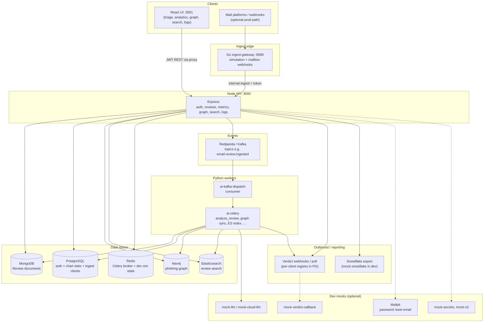
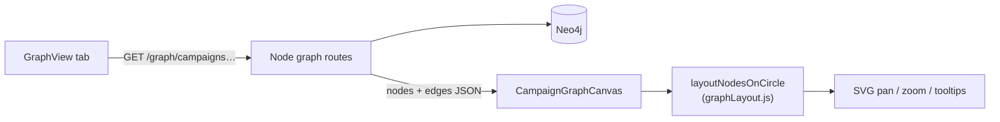

# End-to-end system flowchart

One-page map of how the **Suspicious Email Triage** monorepo fits together in a typical **dev** or production deployment. For narrative detail, see [arch_guide_overview.md](arch_guide_overview.md) and [arch_guide_system_comprehensive.md](arch_guide_system_comprehensive.md). For feature inventory, see [arch_guide_features_catalog.md](arch_guide_features_catalog.md).

---

## Whole-project flow (analyst path + async pipeline)



**How to read this diagram**

| Arrow | Meaning |
|-------|---------|
| Browser → Node | Primary path: submit reviews, poll status, dashboards, Neo4j graph API, unified log search. |
| Mail → Go gateway → Node | Mailbox ingest: same internal persist path as simulation ticks in dev. |
| Node → Kafka → Python | Ingest event decouples HTTP from scoring; Celery updates Mongo and side effects. |
| Node / Celery → Neo4j / ES | Graph campaigns and keyword search after reviews complete. |
| Verdict / Snowflake | Optional outbound integrations; dev uses mock containers. |

---

## Phishing graph UI (where `layoutNodesOnCircle` fits)

Analyst opens **Phishing graph** → Node reads Neo4j → JSON nodes/edges → React `GraphView` → `CampaignGraphCanvas` assigns **circular x/y** with `layoutNodesOnCircle` → SVG draw. See [graph_guide_neo4j_phishing.md](graph_guide_neo4j_phishing.md).



---

## Related diagrams elsewhere

| Document | Focus |
|----------|--------|
| [arch_guide_overview.md](arch_guide_overview.md) | Text main flow + sequence diagram (submit → poll → complete) |
| [arch_guide_system_comprehensive.md](arch_guide_system_comprehensive.md) | Use cases UC1–UC4, Python scoring flowchart |
| [data_guide_kafka_events.md](data_guide_kafka_events.md) | Topic and consumer detail |
| [data_guide_agent_triage.md](data_guide_agent_triage.md) | Agent FSM flow |
| [data_guide_mailbox_ingest_gateway.md](data_guide_mailbox_ingest_gateway.md) | Go gateway path |

---

## Command you can run (this guide) {#run-one-command}

<div style="background:#eef1f5;padding:1rem 1.25rem;border-left:4px solid #64748b;margin:1rem 0;border-radius:4px;">

<p><strong>Run in terminal</strong> — confirm API + graph path after stack is up</p>

```bash
cd ~/suspicious-email-triage
curl -sS http://localhost:3000/health/live
curl -sS -H "Authorization: Bearer YOUR_JWT" http://localhost:3000/graph/campaigns | python3 -m json.tool | head
```

</div>
